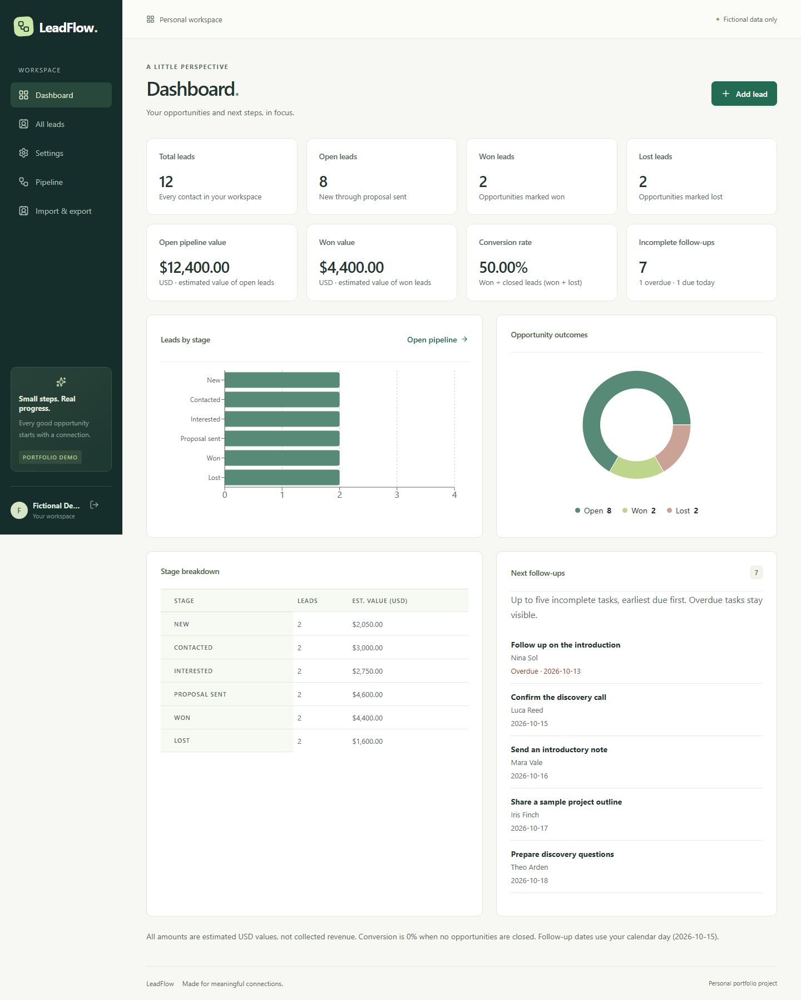

# LeadFlow

A focused CRM for freelancers and small businesses, built as a **personal portfolio demonstration**. This is not commissioned client work. All included contacts, companies and opportunities are fictional.

The local MVP includes isolated user accounts, lead CRUD/search/filter/sort, a persisted six-stage Kanban, notes, follow-up tasks, activity history, sales metrics/charts and validated CSV import/export. An opt-in fictional demo fills an empty workspace.

## Run locally on Windows

Verified environment: Python 3.14.4, Node 24.14.1/npm 11.11.0 and PostgreSQL 18.6. Python, Node/npm and PostgreSQL tools (pg_ctl, initdb, psql) must be on PATH. Docker is not required. Other platforms and a clean-machine installation have not been tested.

Run once from the repository root:

~~~powershell
powershell -NoProfile -ExecutionPolicy Bypass -File scripts/backend.ps1 setup
powershell -NoProfile -ExecutionPolicy Bypass -File scripts/frontend.ps1 setup
powershell -NoProfile -ExecutionPolicy Bypass -File scripts/database.ps1 start
powershell -NoProfile -ExecutionPolicy Bypass -File scripts/backend.ps1 migrate
~~~

Start the API in one terminal:

~~~powershell
powershell -NoProfile -ExecutionPolicy Bypass -File scripts/backend.ps1 run
~~~

Start the frontend in another terminal:

~~~powershell
powershell -NoProfile -ExecutionPolicy Bypass -File scripts/frontend.ps1 run
~~~

Open **http://localhost:5173**. Use localhost to match the configured Origin. Register using a password you choose for this local demo; no default account/password is supplied. In **Settings**, confirm the fictional demo and select **Load fictional demo**, then **Explore dashboard**. Loading is available only while the workspace has no leads. Existing records are never replaced; repeat loading is refused. Seeding creates no account credentials.

The seed adds 12 leads (two per stage), eight tasks and 20 creation-history entries. Initial metrics: 12 total, eight open, two won, two lost, USD 12,400 open value, USD 4,400 won value and 50% conversion. These are fictional fixture totals, not business results. Task deadlines are relative to the UTC loading day and are not reset on later visits.

For later sessions, start the database, API and frontend. Setup/migrations need rerunning only after relevant environment/schema changes. Stop API/frontend with Ctrl+C in their terminals; stop only this project's database with scripts/database.ps1 stop.

See [the five-minute demo guide](docs/DEMO_GUIDE.md) for a walkthrough, sample CSV and troubleshooting.

## Data and local boundaries

The database helper initializes only ignored .local/postgres at 127.0.0.1:55433, creates leadflow and disposable leadflow_test, and writes ignored .env only if absent. It does not modify another PostgreSQL service or overwrite existing configuration. The cluster trusts loopback clients without a password; it must contain fictional data only and must not be exposed publicly.

API: http://127.0.0.1:8000, OpenAPI /docs, liveness /health, database readiness /api/v1/health. Vite proxies /api while preserving Origin. Tests intentionally reset only the exact guarded loopback leadflow_test database.

Public demo deployment is being prepared on Render Free with a separate Neon Free PostgreSQL database. See [deployment instructions and live evidence](docs/DEPLOYMENT.md). Local HTTP cookies remain development-only; the hosted entry point requires HTTPS and Secure cookies. See [SECURITY.md](SECURITY.md).

## Product behavior

- **Leads:** required name, optional contact fields/notes, six stages and nonnegative USD estimates. Search/filter/sort/pagination are server-backed; applied filters remain in the URL.
- **Pipeline:** native drag handles persist changes with history. Selectors support keyboard/touch; failed writes recover saved state. Stages load 20 cards at a time. Manual ordering and touch drag gestures are not implemented.
- **Follow-ups:** create/edit/complete/reopen/delete, calendar deadlines and overdue labels. History is read-only; changes and history commit together. No reminders are delivered.
- **Dashboard:** owner-scoped PostgreSQL aggregates. Open excludes won/lost; conversion is won divided by closed leads, or zero with none closed. Values are unweighted estimates, not revenue. The next-task list shows five incomplete tasks, including overdue items.
- **CSV:** UTF-8, comma separator/header, at most 2 MiB/5,000 records/32 columns. Map fields, review and confirm. Invalid rows block saving unless partial import is explicit. Duplicate owned/file emails are skipped; email-free contacts have no reliable deduplication.
- **Export:** all owned lead fields, independent of filters; UTF-8 BOM and spreadsheet formula neutralization. Its added apostrophe remains on reimport.
- **Accessibility:** keyboard focus, skip link, labeled scroll regions, associated field feedback and reduced motion. Reviewed at 320/768/1440px in Chromium. Tables/board intentionally scroll horizontally; this is not an assistive-technology certification.

## Stack and structure

React/TypeScript/Vite, React Router, TanStack Query, React Hook Form, Zod and Recharts; FastAPI, SQLAlchemy 2, Pydantic, Alembic and PostgreSQL. Native drag/select controls avoided an extra dependency.

backend/app contains API/configuration/models; backend/alembic migrations; backend/tests PostgreSQL/live HTTP tests. frontend/src contains screens/component tests; frontend/e2e Chromium journeys. scripts contains PowerShell helpers; demo/contacts.csv is a mixed-quality fictional import; docs contains guides/evidence.

## Verify

With dependencies installed and the project database running:

~~~powershell
powershell -NoProfile -ExecutionPolicy Bypass -File scripts/verify.ps1
~~~

This runs backend tests/checks/audit, then frontend tests/checks/audit and Chromium **sequentially**, stopping on failure. If Chromium is missing, run npx playwright install chromium from frontend/. Do not run separate database/browser suites concurrently. Audit steps require network access to advisory services.

Final local verification: **183 backend tests, 34 frontend tests and three Chromium journeys passed**. Precise evidence/limits: [RELEASE_REPORT.md](RELEASE_REPORT.md), [TESTING.md](TESTING.md) and [regression review](docs/REGRESSION_REPORT.md). Test credentials are generated at runtime. Runtime artifacts remain ignored; selected fictional demo screenshots are intentionally included in docs/images.

Portfolio copy: [PORTFOLIO_DESCRIPTION.md](PORTFOLIO_DESCRIPTION.md), [CASE_STUDY.md](CASE_STUDY.md). Contracts: [ARCHITECTURE.md](ARCHITECTURE.md). Delivery: [ROADMAP.md](ROADMAP.md), [phase log](docs/PHASE_LOG.md).
